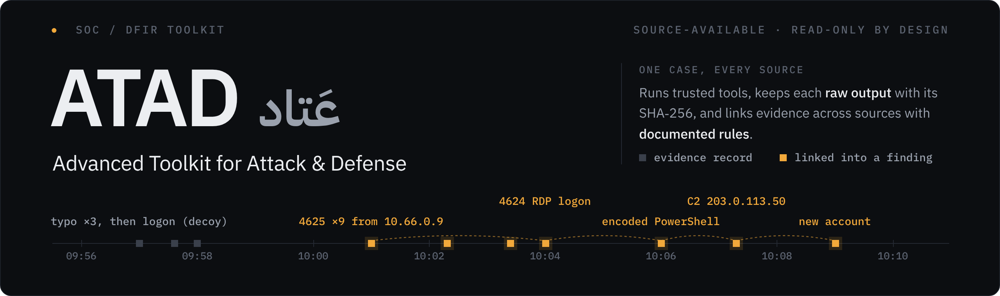
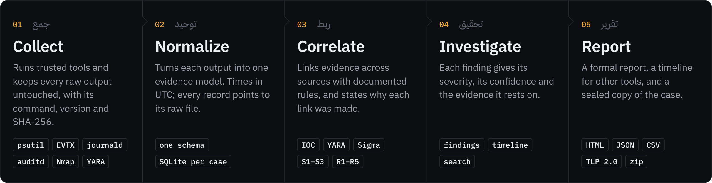
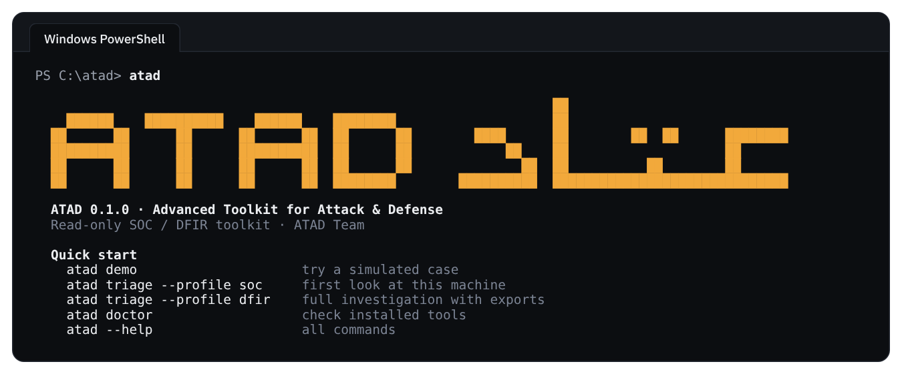
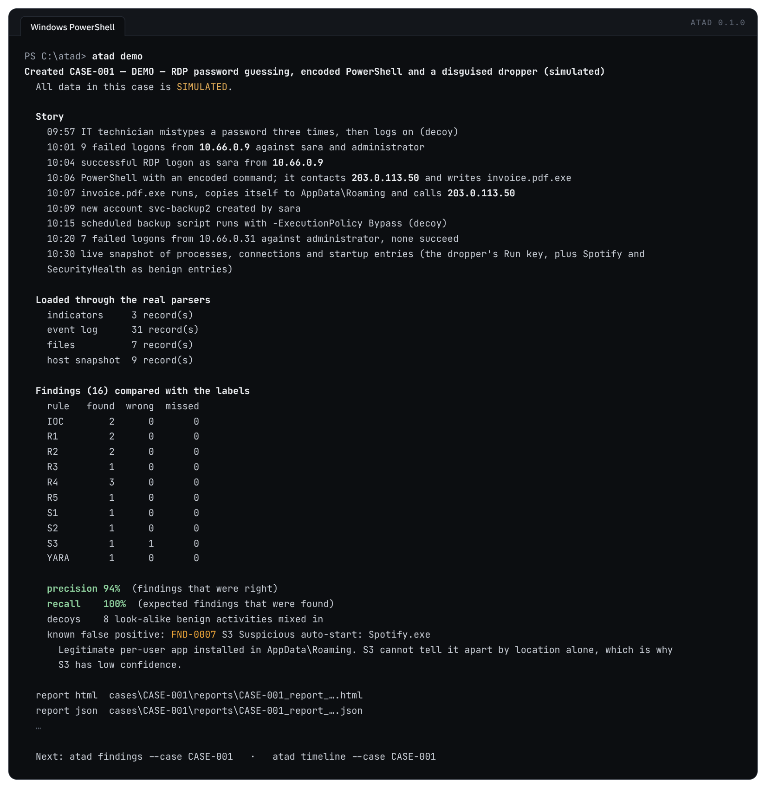
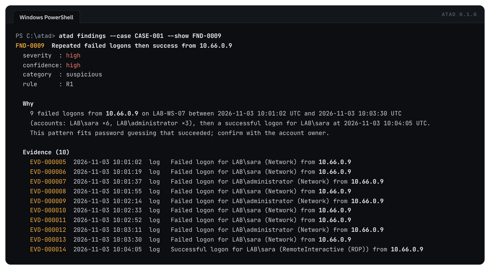
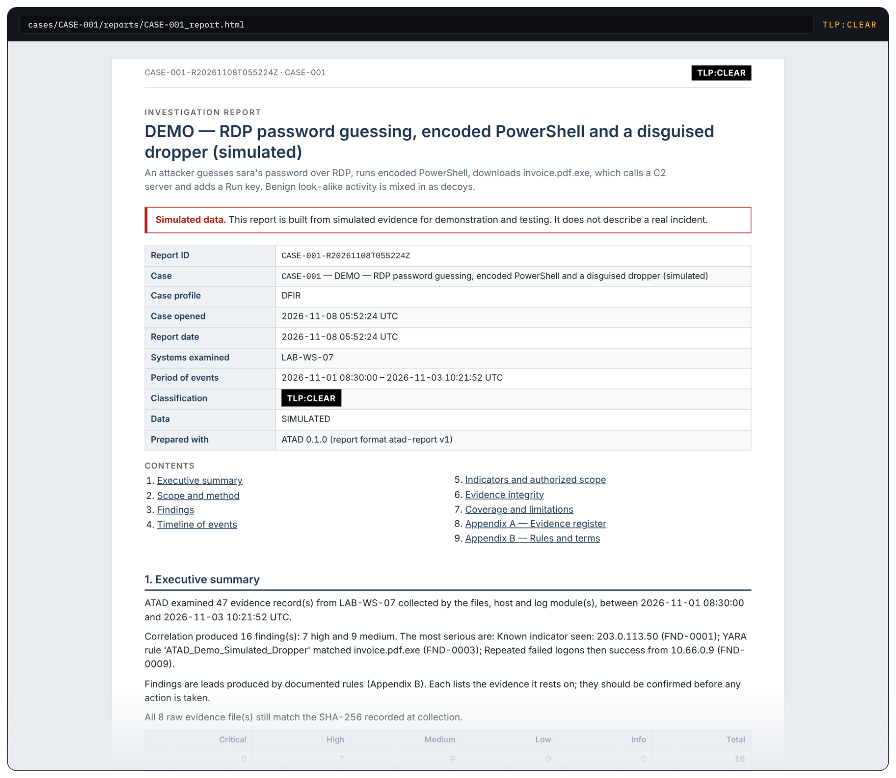

<p align="center">
  
</p>

<p align="center">
  <a href="https://github.com/HoorFawaz/atad/actions/workflows/ci.yml"></a>
  
  
  
  <a href="LICENSE"></a>
</p>

<p align="center">
  <b>One command line for the first hours of an investigation.</b><br>
  ATAD runs trusted security tools, keeps every raw output as evidence, links what it finds across sources,<br>
  and writes a formal report that shows <i>why</i> each finding was made.
</p>

<p align="center" dir="rtl">
  <b>عَتاد</b> أداة سطر أوامر للتحقيق الرقمي ومراكز العمليات الأمنية: تجمع الأدلة، وتربطها، وتكتب التقرير.
</p>

<p align="center">
  <a href="#see-it-in-action">See it in action</a> ·
  <a href="#install">Install</a> ·
  <a href="#quick-start">Quick start</a> ·
  <a href="#what-atad-checks">What ATAD checks</a> ·
  <a href="docs/architecture.md">Architecture</a> ·
  <a href="docs/risks.md">Risk register</a>
</p>

---

## Why ATAD

A first response usually means running five tools, copying their output into a
document, and connecting the dots by hand. Each step can lose evidence or hide a
mistake. ATAD does the routine part in one pass and keeps it accountable.

| The usual problem | What ATAD does |
|---|---|
| Tool outputs are scattered and easy to lose | Every raw output is stored in the case, read-only, with its command, version and SHA-256 |
| Each tool speaks its own format and time zone | All evidence goes into one model, with times in UTC |
| Links between events live in the analyst's head | Documented rules link evidence across sources, and each finding says why |
| "Nothing found" may mean "the tool did not run" | Every step reports its status: done, limited, partial, failed or skipped |
| Reports are rebuilt by hand for every case | A formal HTML / JSON report, a timeline for other tools, and a sealed case archive |

<p align="center">
  
</p>

---

## See it in action

**Start here.** Run `atad` on its own to see the commands to begin with.

<p align="center"></p>

**A full case in one command.** `atad demo` builds a simulated intrusion (password
guessing over RDP, encoded PowerShell, a disguised dropper, a new account) mixed
with harmless look-alike activity, runs it through the real parsers and rules, and
scores the result against the known answers.

<p align="center"></p>

**Every finding explains itself.** The reason, the time window and each piece of
evidence behind it:

<p align="center"></p>

**A report you can hand over.** Structured after the SWGDE report template, with a
document control table, executive summary, findings with their basis, a timeline,
an evidence-integrity check, coverage and limitations, and appendices.

<p align="center"></p>

### Demo results

| Measure | Result | Meaning |
|---|:---:|---|
| Recall | **100%** | every expected finding was found |
| Precision | **94%** | 15 of 16 findings were right |
| Decoys | **8** | harmless look-alike activities mixed in |
| Known false positive | **1** | Spotify starting from AppData, flagged by S3 at low confidence, and explained in the output |

---

## Install

### For analysts — no Python needed (Windows)

1. Download `atad-<version>-windows-x86_64.zip` from [Releases](https://github.com/HoorFawaz/atad/releases).
2. Check it against `SHA256SUMS.txt`, then unzip. Keep the `rules` folder next to `atad.exe`.

```powershell
Get-FileHash .\atad-0.1.0-windows-x86_64.zip -Algorithm SHA256
.\atad\atad.exe doctor
```

### For developers

```bash
python -m venv .venv
.venv\Scripts\activate            # Windows   ·   source .venv/bin/activate on Linux
pip install -e ".[dev,yara]"
atad doctor
```

<details>
<summary>Build <code>atad.exe</code> yourself</summary>

```powershell
pip install -e ".[yara]" pyinstaller
python packaging/build.py          # → dist\atad.exe
```
</details>

---

## Quick start

```powershell
atad doctor                                              # which tools are installed, admin rights
atad demo                                                # a simulated case, end to end
atad triage --profile soc                                # first look at THIS machine
atad triage --profile dfir --path .\evidence --iocs .\iocs.txt
atad triage --profile full --target 192.168.1.15         # adds an Nmap scan of an authorized target
```

`atad triage` runs the modules of a profile, correlates the evidence and writes the report:

| Step | `soc` | `dfir` | `full` |
|---|:---:|:---:|:---:|
| Host: processes, connections, users, start-up entries | ✓ | ✓ | ✓ |
| Event logs | last 24 h | last 7 days | last 7 days |
| Files: hashes, real type, YARA (with `--path`) | ✓ | ✓ | ✓ |
| Network (with `--target`) | ping, DNS | DNS | ping, DNS, **Nmap** |
| IOC list (with `--iocs`) | ✓ | ✓ | ✓ |
| Correlate and report | ✓ | ✓ | ✓ |
| Timeline export and sealed case zip | | ✓ | ✓ |

Then look at the results:

```powershell
atad findings --case CASE-001                            # all findings, most serious first
atad findings --case CASE-001 --show FND-0004            # why, and the evidence behind it
atad timeline --case CASE-001 --findings-only
```

---

## What ATAD checks

### Modules

| Module | Windows | Linux |
|---|---|---|
| **host** | processes, network connections, users, Run keys, Startup folder (shortcuts read to their real target), services | processes, connections, users, systemd units, cron, rc.local, shell start-up files, `authorized_keys` |
| **log** | Security 4624 / 4625 / 4688 / 4720 and Sysmon 1 / 3 / 11 — live, or `.evtx` files copied from another machine | `auth.log` / `secure`, systemd journal, auditd — live, or files copied from another machine |
| **files** | SHA-256 and MD5, metadata, real file type, YARA | same |
| **net** | interfaces, ping, DNS, Nmap (TCP connect, no scripts) | adds routes (`ip route`) and DNS records (`dig`) |
| **ioc** | IP, CIDR range, domain, URL and hash lists (`.txt` / `.csv`, defanged values accepted) | same |

### Detection and correlation rules

| Rule | Finds | Example |
|---|---|---|
| **IOC** | a known indicator in any evidence | a process connects to a C2 address from your list |
| **YARA** | a file matching a YARA rule | a dropper on disk |
| **Sigma** | events matching Sigma rules (SigmaHQ or your own) | hidden, encoded PowerShell |
| **S1** | PowerShell started with an encoded command | `powershell -W Hidden -EncodedCommand …` |
| **S2** | a program disguised as a document or image | `invoice.pdf.exe` |
| **S3** | auto-start from a user-writable folder | a Run key pointing into `AppData\Roaming` |
| **R1** | repeated failed logons, with or without a success | password guessing over RDP or SSH |
| **R2** | a process connecting to a known indicator | `powershell.exe` → `203.0.113.50` |
| **R3** | a YARA-flagged file that was executed | the dropper runs |
| **R4** | the same indicator in independent sources | a file hash on disk, in a process and in a log |
| **R5** | a cluster of suspicious findings on one host | several of the above within 15 minutes |

Every finding has a **severity** (how serious it would be) and a separate
**confidence** (how strongly the evidence supports it). How confidence is set,
and the sources behind it, are in [architecture §7](docs/architecture.md#7-correlation-rule-catalogue-mvp).

### Principles

| Principle | What it means |
|---|---|
| **Read-only** | ATAD never deletes, quarantines, blocks or runs what it investigates |
| **Evidence first** | raw outputs are kept unchanged with their SHA-256; `atad report` checks them again and exits with code 4 if one changed |
| **Authorized scope** | network checks only reach targets in the case's scope; public addresses need `--allow-public` |
| **Explainable** | every finding names its rule, its reason and its evidence |
| **Honest coverage** | a missing tool or missing admin rights is reported, never shown as "nothing found" |

---

## Reports and exports

```powershell
atad report --case CASE-001                              # HTML + JSON in the case's reports folder
atad report --case CASE-001 --tlp red                    # TLP 2.0: clear, green, amber (default), amber+strict, red
atad export timeline --case CASE-001                     # CSV + JSONL for Timesketch, Timeline Explorer, Elastic
atad export case --case CASE-001                         # the whole case as one zip with SHA256SUMS.txt
```

---

<details>
<summary><b>Full command reference</b></summary>

```powershell
# Cases and scope
atad case new --name "Suspicious workstation" --profile soc
atad case list
atad case show CASE-001
atad scope add --case CASE-001 --target 192.168.1.15

# Files (read-only)
atad files --path .\evidence                             # hash + info + YARA
atad files --path .\evidence --only hash,scan
atad files --path .\evidence --skip scan
atad files hash --path .\evidence\sample.exe
atad files --path E:\copied --source-host WS-07          # files copied from another machine

# Event logs
atad log                                                 # live, on the suspect machine (admin / root)
atad log --only security --hours 48
atad log import --path E:\logs --source-host WS-07       # .evtx copied from another machine
atad log import --path ./copied-logs --source-host web01 --timezone +03:00   # Linux logs
atad log search --case CASE-001 --keyword failed_login

# This machine
atad host                                                # info, processes, connections, users, startup
atad host --only processes,connections
atad host startup

# Network (authorized targets only)
atad net --target 192.168.1.15                           # interfaces + ping + Nmap + DNS
atad net --target 192.168.1.0/24 --only scan --profile quick
atad net scan --target 192.168.1.15 --ports 22,80,443,3389
atad net interfaces

# Indicators and correlation
atad ioc load --case CASE-001 --path .\iocs.txt
atad ioc list --case CASE-001
atad ioc check --case CASE-001
atad correlate --case CASE-001
atad correlate --case CASE-001 --config .\correlation.yaml
atad correlate --case CASE-001 --sigma .\sigma\rules
atad findings --case CASE-001 --min-severity high
```

Without `--case`, `atad net` creates a case and authorizes its `--target`.
With `--case`, the target must already be in that case's scope (`atad scope add`).
</details>

<details>
<summary><b>Configuration</b></summary>

**Rules**

| What | Where ATAD looks |
|---|---|
| YARA rules | `--rules`, then `$ATAD_RULES`, then `./rules`. The rules in `rules/demo/` are for `atad demo` only |
| Sigma rules | `--sigma`, then `$ATAD_SIGMA`, then `./rules/sigma`. SigmaHQ rules are not bundled: download them from [SigmaHQ](https://github.com/SigmaHQ/sigma). Findings name each rule's author, as its licence requires |

**Correlation thresholds** (`atad correlate --config correlation.yaml`)

```yaml
r1_min_failures: 5      # failed logons in one burst
r1_window_minutes: 10
r5_min_findings: 3      # suspicious findings on one host
r5_window_minutes: 15
disabled_rules: [S2]
```

**Environment variables**

| Variable | Effect |
|---|---|
| `ATAD_HOME` | where cases are stored (default `./cases`; same as `--home`) |
| `ATAD_RULES` | YARA rules folder |
| `ATAD_SIGMA` | Sigma rules folder; `none` turns Sigma off |
| `ATAD_NO_PROGRESS=1` | no progress counter on long steps |
| `ATAD_NO_BANNER=1` | no drawing on the welcome screen |

**Collection modes**

| Mode | Meaning |
|---|---|
| `local` | ATAD runs on the suspect machine and collects from it |
| `import` | evidence copied from the suspect machine is imported with `--path` |
| `network` | network checks against an authorized `--target` |

On Linux, syslog lines that have no year or time zone take them from the file's
date and `--timezone` (import) or this machine's zone (live); every record notes which.
</details>

---

## Documentation

| Document | Contents |
|---|---|
| [Architecture](docs/architecture.md) | design decisions, evidence model, rule catalogue with sources, CLI design |
| [Risk register](docs/risks.md) | 18 rated risks, the control for each, and the test that checks it |
| [Changelog](CHANGELOG.md) | what changed in each version |

## Tests

```bash
pytest                                   # 350+ tests: unit, integration, labelled scenario
ruff check src tests packaging           # code checks
```

GitHub Actions runs both on every push, on Windows and Linux with Python 3.11, 3.12 and 3.13.

## Roadmap

| Status | Item |
|---|---|
| Done | Defensive modules: host, logs, files, network, IOC (Windows and Linux) |
| Done | Correlation rules, Sigma support, formal reports and exports |
| Done | Triage profiles, simulated demo with metrics, single-file Windows build |
| Next | Offensive (red team) modules for authorized assessments |

---

## ATAD Team · فريق عَتاد

| | Part · الجزء | GitHub |
|---|---|---|
| **Hoor Fawaz** · حور فواز | Core, correlation rules, IOC, reports, license and build · الأساس، قواعد الربط، المؤشرات، التقارير، الرخصة والبناء | [@HoorFawaz](https://github.com/HoorFawaz) |
| **Danah Fawaz** · دانة فواز | Logs, host, files, network, Sigma, triage and demo · السجلات، الجهاز، الملفات، الشبكة، Sigma، الفرز والعرض التجريبي | [@danahfawaz](https://github.com/danahfawaz) |

ATAD is owned jointly by the ATAD Team. · عَتاد ملكية مشتركة لفريق عَتاد.

## License

Copyright (C) 2026 ATAD Team (Hoor Fawaz, Danah Fawaz)

ATAD is **source-available** under the ATAD Source-Available License 1.0
([English](LICENSE) · [العربية — النص الرسمي](LICENSE.ar)). It is not an
OSI-approved open source license.

| Use | Terms |
|---|---|
| Personal and internal use, including by companies | Free |
| Using ATAD as a tool in paid services (SOC, incident response, consulting) | Free |
| Free redistribution, with source, notices and a new name for modified versions | Free |
| Selling ATAD, bundling it in a paid or closed product, or offering it as a paid service | Written permission required |

Reports and evidence produced with ATAD belong to their user.
For commercial licensing: Atad.Team@outlook.com

Third-party components and their licenses are listed in [NOTICE](NOTICE).
Use of the ATAD name and logo is covered by [TRADEMARKS.md](TRADEMARKS.md).
